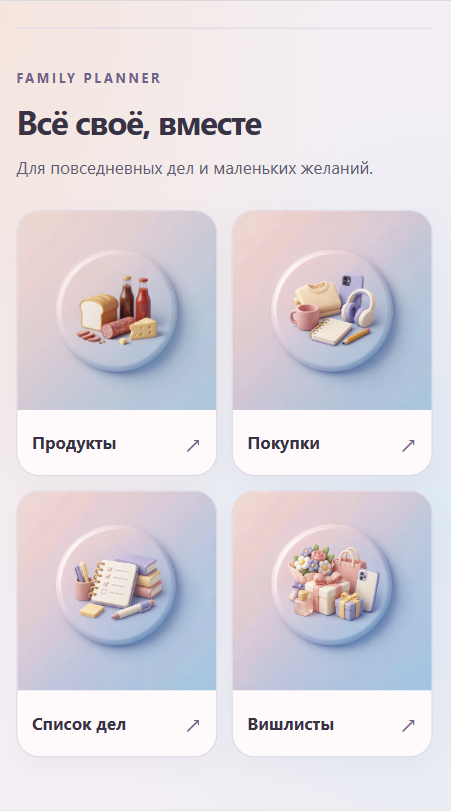
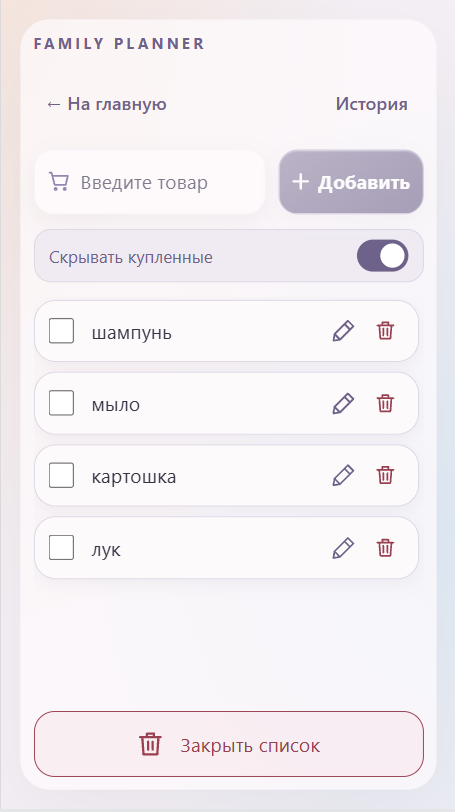
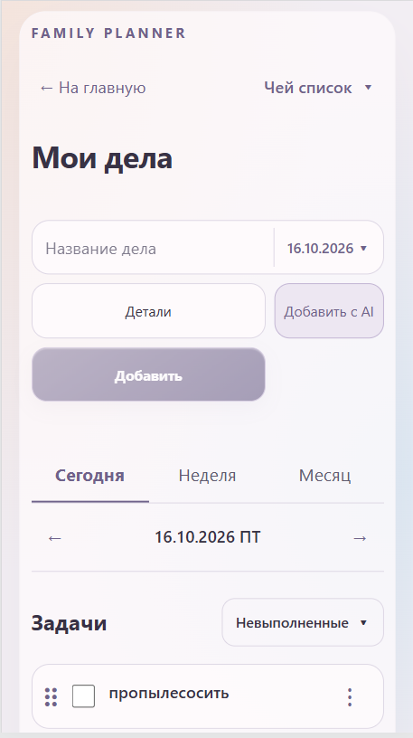
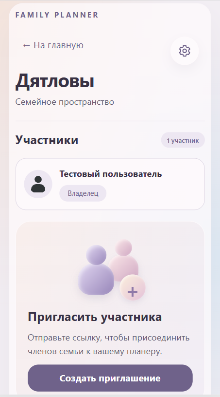

# Family AI Planner

Family AI Planner — семейный планер в Telegram Mini App с AI-обработкой: искусственный интеллект превращает описание дел обычным текстом в задачи и сортирует продукты по отделам магазина. Приложение помогает вместе вести покупки, планировать дела и сохранять идеи подарков. У каждой семьи своё пространство, доступное её участникам.

## Что можно делать

- **Продукты:** общий список с отметками купленного, AI-сортировкой по отделам магазина и историей закрытых списков. Товары добавляются сразу; сортировка запускается после паузы во вводе.
- **Покупки:** отдельный общий список вещей для дома и других покупок.
- **Мои дела:** задачи на день, неделю и месяц, задачи без точного дня, переносы и просмотр списков участников. Можно добавить дело другому участнику; изменяет и выполняет его владелец списка. AI помогает разобрать текст в задачи перед сохранением.
- **Вишлисты:** общие списки желаний, создаваемые по имени без привязки к аккаунту. К желаниям можно добавить ссылку, заметку и цену, а исполненные — отметить.
- **Семья:** приглашение участников по ссылке, управление составом, название и часовой пояс.

Интерфейс адаптирован для телефона и браузера. Без AI доступны ручное добавление и остальные функции приложения.

## Скриншоты

<table>
  <tr>
    <th>Главная</th>
    <th>Список продуктов</th>
  </tr>
  <tr>
    <td></td>
    <td></td>
  </tr>
  <tr>
    <th>Мои дела</th>
    <th>Семья и настройки</th>
  </tr>
  <tr>
    <td></td>
    <td></td>
  </tr>
</table>

## Локальный запуск

Нужны Node.js 24 и npm. Все команды выполняются из корня проекта. В Windows PowerShell при блокировке `npm.ps1` используйте `npm.cmd` вместо `npm`.

**1. Установите зависимости и соберите сервер:**

```sh
npm ci
npm ci --prefix server
npm run build --prefix server
```

**2. Подготовьте базу данных.** При первом запуске:

```sh
npm run db:init --prefix server
```

Если база уже существует, вместо `db:init` выполните её обновление при остановленном сервере:

```sh
npm run db:migrate --prefix server
```

По умолчанию данные хранятся в `server/data/family-planner-v2.db`. Инициализация не перезаписывает существующую базу; перед миграциями автоматически создаётся резервная копия.

**3. Запустите сервер в первом терминале:**

```sh
npm run server-dev:auth --prefix server
```

**4. Запустите интерфейс во втором терминале:**

```sh
npm run dev
```

Откройте [localhost:5173](http://localhost:5173), воспользуйтесь тестовым входом и создайте семью. Для этого режима Telegram-токен не нужен; тестовый вход предназначен только для локальной разработки.

Для AI-функций добавьте `OPENAI_API_KEY` в `server/.env`. Без ключа можно пользоваться приложением вручную.

## Запуск в Telegram и на сервере

Для входа через Telegram нужны бот, HTTPS-адрес приложения и настройки `TELEGRAM_BOT_TOKEN` и `APP_ORIGIN` в `server/.env`. На сервере приложение запускается через Docker Compose; SQLite хранится в постоянном volume.

Подробности: [авторизация](docs/AUTH_CHECK.md), [развёртывание](docs/FIRST_RELEASE.md), [база и резервные копии](docs/DATABASE.md).

## Для разработчиков

Стек: React, TypeScript, Node.js / Express, SQLite и OpenAI API.

Проверки из корня проекта:

```sh
npm run lint
npm run build
npm run build --prefix server
npm test --prefix server
```

План развития — [docs/CODEX_PLAN.md](docs/CODEX_PLAN.md). Описание функций и проверки: [покупки](docs/SHOPPING_CHECK.md), [дела](docs/TASKS_CHECK.md), [вишлисты](docs/WISHLISTS_CHECK.md).
